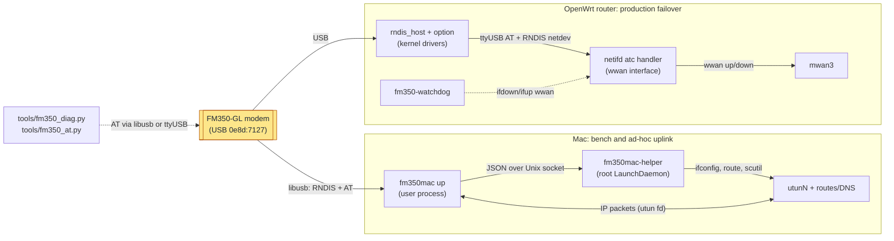
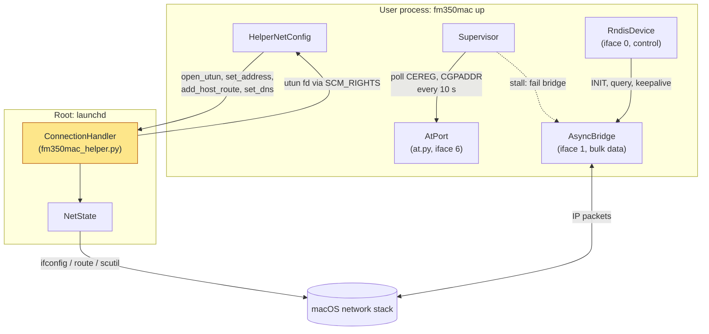
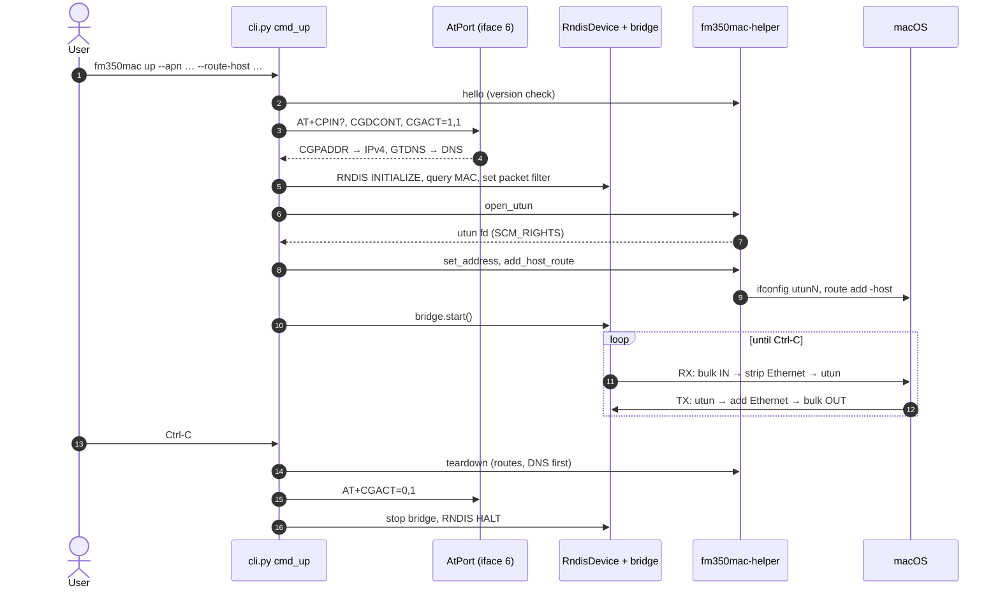
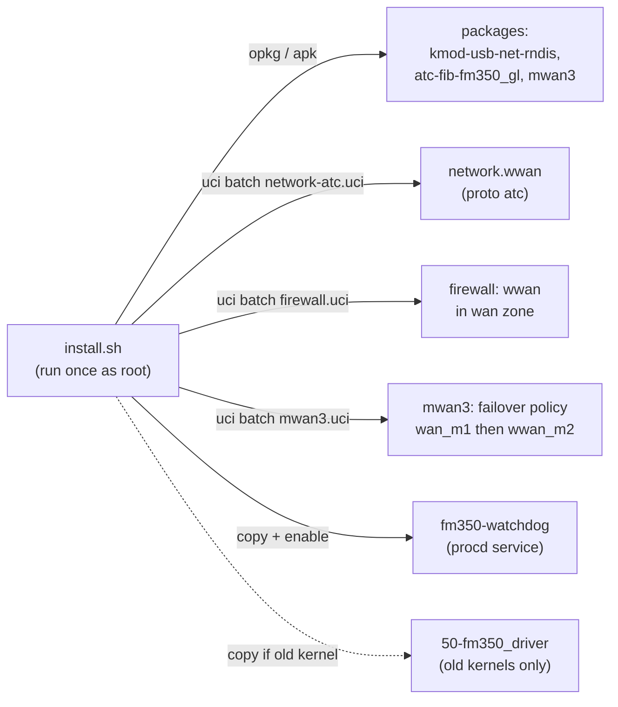
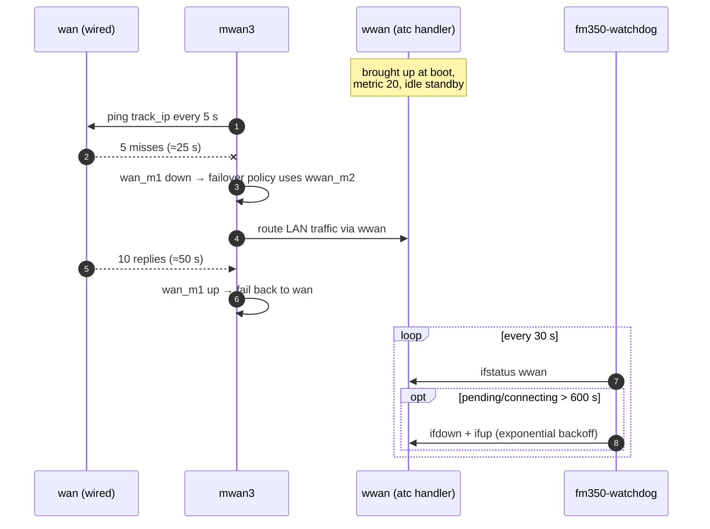
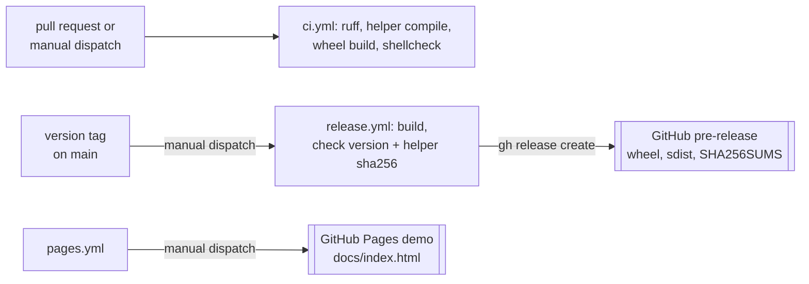

# Architecture: how fm350-usb fits together

A map for newcomers: what runs where, what happens when you run the main
commands, and where the code for each part lives. For the reasons behind the
macOS design (rejected alternatives, measurements, tuning), read
[macos-driver.md](macos-driver.md); for router setup steps, read
[setup-guide.md](setup-guide.md). Terms are defined in the
[glossary](glossary.md).

## In one paragraph

The repo makes a Fibocom FM350-GL 5G modem (or its Dell twin, the DW5931e)
usable over USB on two kinds of host. On an **OpenWrt router**, shell scripts
install a third-party netifd protocol handler and an `mwan3` policy so the
modem becomes a backup WAN that takes over when the wired line drops, plus a
watchdog that unsticks the handler when it hangs. On a **Mac**, `fm350mac`, a
Python package with no runtime dependencies beyond the system libusb, speaks
the modem's RNDIS protocol from user space and hands IP packets to a `utun`
interface; a tiny root helper does the only privileged steps. Standalone
diagnostic tools in `tools/` talk AT commands to the modem on either host.
The two host paths are alternatives for the same modem, never used at once.

## System overview

What is it made of, and what runs where?

The modem exposes two USB functions that both hosts use: an **RNDIS network
interface** (USB interfaces 0 and 1) that carries Ethernet frames, and a
**vendor serial interface** for AT commands (interface 6 in USB mode 41,
interface 4 in mode 40). On the router, kernel drivers turn these into a
network device and a `/dev/ttyUSBn` node, and an off-the-shelf protocol
handler drives them; this repo only installs and configures it. On the Mac,
there are no such drivers, so `fm350mac` claims both interfaces through
libusb itself. The diagnostic tools pick whichever AT transport the host
offers ([`open_transport`](../tools/fm350_diag.py)).

Where in the code:

- Mac: [fm350mac/src/fm350mac/cli.py](../fm350mac/src/fm350mac/cli.py), [helper/fm350mac_helper.py](../fm350mac/src/fm350mac/helper/fm350mac_helper.py)
- Router: [openwrt/install.sh](../openwrt/install.sh), [openwrt/uci/](../openwrt/uci/), [openwrt/files/](../openwrt/files/)
- Tools: [tools/fm350_diag.py](../tools/fm350_diag.py), [tools/fm350_at.py](../tools/fm350_at.py)

## The Mac path: fm350mac

### How it runs

What processes exist on the Mac, and what does each one own?

Everything that touches USB runs as the logged-in user; macOS lets an
ordinary process claim the modem's interfaces through libusb. Only creating
the `utun` and changing addresses, routes and DNS need root, so that lives in
a separate, deliberately small helper that launchd starts on demand
(socket activation on `/var/run/fm350mac-helper.sock`). The helper accepts
connections only from the one uid it was installed for, validates every
request against a fixed schema, and runs commands as argument lists. When the
`up` process exits or dies, its socket closes and the helper's
`NetState.teardown()` removes every route, address and DNS key it added, so a
`kill -9` does not leave the Mac routing into a dead tunnel.

Inside the user process, three threads move packets (libusb event loop, tx,
RNDIS control) and the `Supervisor` thread watches the session. The
packet-level detail (Ethernet shim, ARP, backpressure, keepalive watchdog) is
drawn and explained in [macos-driver.md, "Architecture"](macos-driver.md#architecture-option-5).

Where in the code:

- [helper_client.py](../fm350mac/src/fm350mac/helper_client.py): `HelperClient`, `HelperNetConfig` (the client side of the socket protocol)
- [helper/fm350mac_helper.py](../fm350mac/src/fm350mac/helper/fm350mac_helper.py): `serve_forever`, `ConnectionHandler._dispatch`, `NetState`
- [helper_admin.py](../fm350mac/src/fm350mac/helper_admin.py): `fm350mac helper install|uninstall|status`, writes the LaunchDaemon plist
- [async_bridge.py](../fm350mac/src/fm350mac/async_bridge.py), [usb_async.py](../fm350mac/src/fm350mac/usb_async.py): the default data pump and its ctypes libusb binding
- [supervisor.py](../fm350mac/src/fm350mac/supervisor.py): registration/PDP polling, stall detection, reconnect

### What happens on `fm350mac up --apn <apn> --route-host <ip>`

Which part of the system does each step of a session reach?

Steps 3–4 open the cellular data session (the PDP context) over AT; the
network, not DHCP, assigns the address. Steps 5–9 build the local side:
RNDIS on the modem, then a `utun` that the helper creates and passes back as
a file descriptor, then only the host routes you asked for, so a metered SIM
carries nothing else. Teardown (steps 14–16) runs in the reverse order and is
also triggered by SIGTERM/SIGHUP. If the modem crashes and re-enumerates
mid-session, `cmd_up` keeps the `utun`, drops routes, waits for the device
and rebuilds steps 3–11; the rules are in
[macos-driver.md, "Failure handling and rebuilds"](macos-driver.md#failure-handling-and-rebuilds).
`--dry-run` stops after read-only AT queries and prints the plan;
`--loopback` swaps the modem for an in-process fake.

Where in the code:

- [cli.py](../fm350mac/src/fm350mac/cli.py): `cmd_up` (steps 1–16), `_resolve_helper`, `_ShutdownGuard`, `_wait_for_reenumeration`
- [at.py](../fm350mac/src/fm350mac/at.py): `AtPort`, `setup_pdp`, `deactivate`
- [rndis_device.py](../fm350mac/src/fm350mac/rndis_device.py), [rndis.py](../fm350mac/src/fm350mac/rndis.py), [usb_transport.py](../fm350mac/src/fm350mac/usb_transport.py): RNDIS control and its message codec
- [ethernet.py](../fm350mac/src/fm350mac/ethernet.py): Ethernet strip/wrap and ARP replies
- [utun.py](../fm350mac/src/fm350mac/utun.py), [netconfig.py](../fm350mac/src/fm350mac/netconfig.py): the `--no-helper` (run as root) variants of the helper's work
- [loopback.py](../fm350mac/src/fm350mac/loopback.py): the fake modem behind `--loopback`

## The router path: OpenWrt failover

### What `install.sh` sets up

Which pieces end up on the router, and who starts them?

The repo writes no data-path code for the router: the kernel's
`rndis_host` and `option` drivers expose the modem, and mrhaav's `atc`
netifd handler (downloaded by `install.sh`) runs the AT dialogue and brings
`wwan` up. `install.sh` applies idempotent `uci batch` snippets, marks every
section it owns with `fm350_owned='1'`, and records the originals it changes
under `/etc/fm350-usb` and in `fm350_orig_policy` options, so
[uninstall.sh](../openwrt/uninstall.sh) restores them exactly. The
`--proto xmm` option is gone (the watchdog and decoder are atc-specific). Details: [openwrt/README.md](../openwrt/README.md).

Where in the code:

- [openwrt/install.sh](../openwrt/install.sh), [openwrt/uninstall.sh](../openwrt/uninstall.sh)
- [openwrt/uci/](../openwrt/uci/): `network-atc.uci`, `firewall.uci`, `mwan3.uci`, `fm350-watchdog.uci`
- [openwrt/files/usr/lib/fm350/at-port.sh](../openwrt/files/usr/lib/fm350/at-port.sh): finds the modem's AT tty, shared by install, status and watchdog
- [openwrt/fm350-status.sh](../openwrt/fm350-status.sh): read-only status, installed as `/usr/bin/fm350-status`

### What happens when the wired line drops

`wwan` is always up as a second route with a higher metric; mwan3 only
decides which member carries LAN traffic (steps 2–6). The probe timings are
set for a metered SIM, so a short blip does not move traffic onto it. The
watchdog loop exists because the `atc` handler can hang in "connecting"
forever after an unexpected `+CME ERROR`; it never restarts while the modem
is absent, the interface is disabled, a pause file exists, or the handler
reported a PIN/PUK error (a restart would resend the PIN). IPv6 is not part
of the failover policy.

Where in the code:

- [openwrt/uci/mwan3.uci](../openwrt/uci/mwan3.uci): tracking intervals, members, `failover` policy, `default` rule
- [openwrt/files/usr/sbin/fm350-watchdog](../openwrt/files/usr/sbin/fm350-watchdog): the loop and its uci options (header comment)
- [openwrt/files/etc/init.d/fm350-watchdog](../openwrt/files/etc/init.d/fm350-watchdog): procd service wrapper

## Where state lives

There is no database. Everything persistent is a config file or a log:

| Host | Location | Holds | Written by |
|---|---|---|---|
| Mac | `/Library/LaunchDaemons/de.fm350mac.helper.plist` | helper LaunchDaemon, allowed uid, socket | `fm350mac helper install` |
| Mac | `/usr/local/libexec/fm350mac-helper` | the helper script (sha256 pinned at install) | `fm350mac helper install` |
| Mac | `/var/log/fm350mac-helper.log` | helper log | launchd |
| Mac | `State:/Network/Service/fm350mac/DNS` | DNS servers (only with `--dns`, removed on exit) | helper via `scutil` |
| Router | `/etc/config/{network,firewall,mwan3,fm350_watchdog}` | uci sections marked `fm350_owned` | `install.sh` |
| Router | `network.fm350_install_state`, `mwan3.fm350_install_state` (uci sections) | the original values `uninstall.sh` restores | `install.sh` |
| Router | `mwan3.wan.fm350_added_track_ip` (uci option) | the track IPs `install.sh` added, so `uninstall.sh` removes only those | `install.sh` |
| Router | `/etc/fm350-usb/` | snapshots of original settings for rollback | `install.sh`, read by `uninstall.sh` |
| Router | `/tmp/fm350-watchdog.pause` | pauses the watchdog until reboot | you, by hand |

## Build and release

How does code get from a commit to a release?

CI runs automatically only for Dependabot pull requests; for other branches a
maintainer dispatches it by hand. A release refuses to build unless the tag
matches `fm350mac.__version__` and the helper's sha256 appears in
[CHANGELOG.md](../CHANGELOG.md), so users can compare it with
`fm350mac helper install --dry-run` before installing. Nothing is published
to PyPI. The unit and emulator test suites (`fm350mac/tests`, `tools/tests`,
`openwrt/tests`) are kept local and are not in the repository, so CI does not
run them.

Where in the code:

- [.github/workflows/ci.yml](../.github/workflows/ci.yml), [release.yml](../.github/workflows/release.yml), [pages.yml](../.github/workflows/pages.yml)
- [fm350mac/pyproject.toml](../fm350mac/pyproject.toml): hatchling build, `fm350mac` console script, ruff rules
- [tools/screenshots.py](../tools/screenshots.py): regenerates the SVG screenshots in `docs/assets/screenshots/`

## Code map

In the order a newcomer would read it:

| Path | Responsibility |
|---|---|
| [fm350mac/src/fm350mac/cli.py](../fm350mac/src/fm350mac/cli.py) | Entry point (`fm350mac` command): argument parsing and every subcommand, including `cmd_up` |
| [fm350mac/src/fm350mac/at.py](../fm350mac/src/fm350mac/at.py) | AT commands over raw USB bulk transfers; PDP setup and teardown |
| [fm350mac/src/fm350mac/cellinfo.py](../fm350mac/src/fm350mac/cellinfo.py) | Parsers for signal, cell, operator and temperature responses (`status`, `doctor`) |
| [fm350mac/src/fm350mac/usb_async.py](../fm350mac/src/fm350mac/usb_async.py) | ctypes binding to libusb-1.0, sync and async transfers |
| [fm350mac/src/fm350mac/usb_transport.py](../fm350mac/src/fm350mac/usb_transport.py) | Finds the modem, claims the RNDIS interfaces |
| [fm350mac/src/fm350mac/rndis.py](../fm350mac/src/fm350mac/rndis.py) | RNDIS message codec (pure) |
| [fm350mac/src/fm350mac/rndis_device.py](../fm350mac/src/fm350mac/rndis_device.py) | RNDIS control: init, query, set, keepalive, halt |
| [fm350mac/src/fm350mac/ethernet.py](../fm350mac/src/fm350mac/ethernet.py) | Ethernet framing and ARP replies (pure) |
| [fm350mac/src/fm350mac/async_bridge.py](../fm350mac/src/fm350mac/async_bridge.py) | Default data pump (`--io async`) |
| [fm350mac/src/fm350mac/bridge.py](../fm350mac/src/fm350mac/bridge.py) | Simpler threaded data pump (`--io sync`, `--loopback`) |
| [fm350mac/src/fm350mac/supervisor.py](../fm350mac/src/fm350mac/supervisor.py) | Session supervision and reconnects |
| [fm350mac/src/fm350mac/helper_client.py](../fm350mac/src/fm350mac/helper_client.py) | Client for the root helper's socket protocol |
| [fm350mac/src/fm350mac/helper/fm350mac_helper.py](../fm350mac/src/fm350mac/helper/fm350mac_helper.py) | The root helper (stdlib only, runs under `/usr/bin/python3`) |
| [fm350mac/src/fm350mac/helper_admin.py](../fm350mac/src/fm350mac/helper_admin.py) | Installs, removes and checks the helper |
| [fm350mac/src/fm350mac/utun.py](../fm350mac/src/fm350mac/utun.py), [netconfig.py](../fm350mac/src/fm350mac/netconfig.py) | `utun` and ifconfig/route/scutil for the `--no-helper` root path |
| [fm350mac/src/fm350mac/loopback.py](../fm350mac/src/fm350mac/loopback.py) | Fake modem for `up --loopback` |
| [fm350mac/src/fm350mac/redact.py](../fm350mac/src/fm350mac/redact.py) | Masks IMEI, IMSI, IPs, PINs in output for bug reports |
| [openwrt/install.sh](../openwrt/install.sh), [uninstall.sh](../openwrt/uninstall.sh) | Router install and exact rollback |
| [openwrt/uci/](../openwrt/uci/) | `uci batch` snippets applied by the installer |
| [openwrt/files/](../openwrt/files/) | Files copied onto the router: watchdog, init script, AT port lookup, hotplug driver binding |
| [openwrt/fm350-status.sh](../openwrt/fm350-status.sh) | Read-only modem status on the router |
| [tools/fm350_diag.py](../tools/fm350_diag.py) | Staged diagnostics with an AT/adb command allowlist ([diagnostics.md](diagnostics.md)) |
| [tools/fm350_at.py](../tools/fm350_at.py) | Send raw AT commands from a Mac |
| [tools/bench-throughput.sh](../tools/bench-throughput.sh), [bench_summarize.py](../tools/bench_summarize.py) | Capped iperf3 benchmarks of `fm350mac` and their summary |
| [tools/module-telemetry.sh](../tools/module-telemetry.sh) | Streams the module's syslog, supply voltage and temperatures over ADB while another command runs ([diagnostics.md](diagnostics.md#recording-the-module-during-a-test-toolsmodule-telemetrysh)) |
| [tools/module-readout.sh](../tools/module-readout.sh) | One-shot read-only snapshot of the module's reset state (PMIC, watchdog, ramoops) over ADB ([diagnostics.md](diagnostics.md#snapshot-of-the-modules-reset-state-toolsmodule-readoutsh)) |
| [docs/index.html](index.html) | Static interactive demo published to GitHub Pages |
